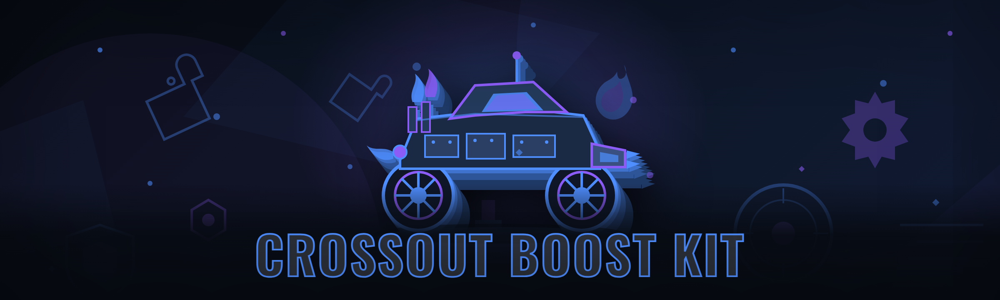

  
  
  

  

  
  
  

---

Crossout Boost Kit: aimbot, ESP wallhack, part farm bot, instant reload and injector loader for Crossout PC.

## Overview

Crossout Boost Kit: aimbot, ESP wallhack, part farm bot, instant reload and injector loader for Crossout PC.

  

## License

[MIT License](LICENSE)

  

